<h1 align="center">Flatmates</h1>

<p align="center">
  <b>Ilustrações Corporate Memphis a partir de um JSON.</b><br>
  Você descreve quem está na cena e como se relacionam. O motor cuida de proporção, perspectiva, oclusão e cor.
</p>

<p align="center">
  <a href="https://github.com/JonathanSantos/flatmates/actions/workflows/ci.yml"></a>
  <a href="https://github.com/JonathanSantos/flatmates/releases/latest"></a>
  
</p>

<p align="center">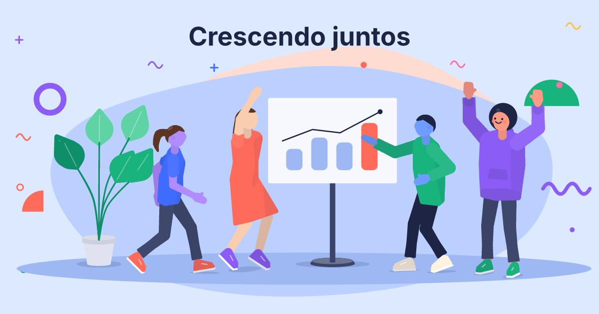</p>

<table>
  <tr>
    <td>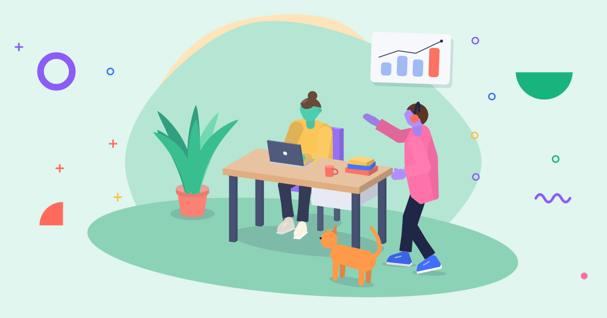</td>
    <td>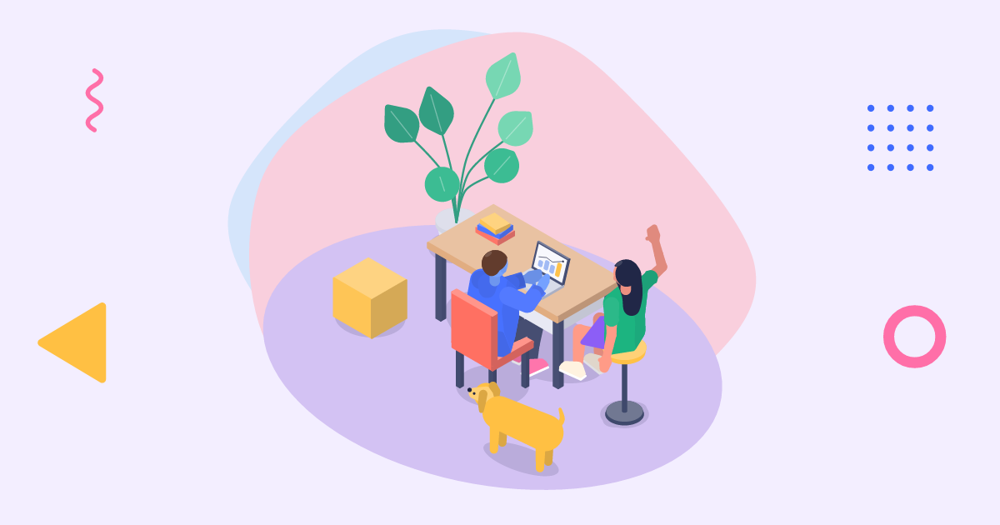</td>
  </tr>
  <tr>
    <td>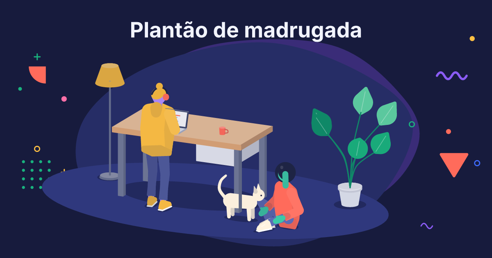</td>
    <td>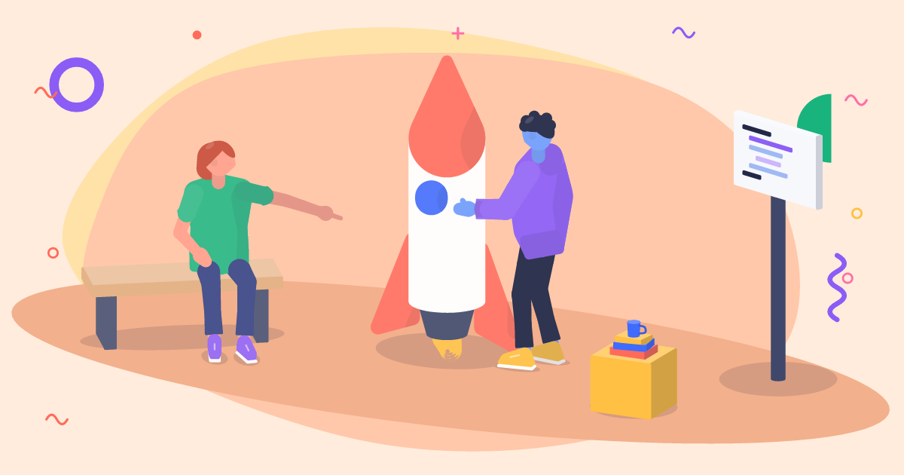</td>
  </tr>
</table>

## Instalar

Baixe o binário da sua plataforma no [último release](https://github.com/JonathanSantos/flatmates/releases/latest):

| Plataforma | Arquivo |
|---|---|
| macOS (Apple Silicon) | `flatmates-aarch64-apple-darwin.tar.gz` |
| macOS (Intel) | `flatmates-x86_64-apple-darwin.tar.gz` |
| Linux x64 | `flatmates-x86_64-unknown-linux-gnu.tar.gz` |
| Linux ARM64 | `flatmates-aarch64-unknown-linux-gnu.tar.gz` |
| Windows x64 | `flatmates-x86_64-pc-windows-msvc.zip` |
| Windows ARM64 | `flatmates-aarch64-pc-windows-msvc.zip` |
| Navegador | `flatmates.wasm` |
| Skill para agentes | `flatmates-skill.zip` (todos os binários dentro) |

Ou compile:

```bash
cargo build --release
```

## Em um minuto

```bash
flatmates example office | flatmates render --png office.png
```

A cena é escrita com o que as coisas são umas para as outras, não com coordenadas:

```json
{
  "theme": "mint",
  "camera": "three-quarter",
  "items": [
    { "id": "mesa", "kind": "desk", "at": [0, 0] },
    { "id": "note", "kind": "laptop", "on": "mesa", "at": [0, -0.16], "facing": 180 },
    { "id": "cadeira", "kind": "chair", "at": [0, -0.6] },
    { "id": "ana", "kind": "person", "sits_on": "cadeira", "uses": "note" },
    { "kind": "person", "near": { "id": "mesa", "side": "right", "gap": 0.3 },
      "face_to": "ana", "look_at": "ana", "pose": "pointing", "points_at": "note" }
  ]
}
```

| Relação | Efeito |
|---|---|
| `on` | Apoia em cima de outro objeto, em quantos níveis quiser. |
| `near` | Põe ao lado (`left`, `right`, `front`, `behind`) com uma folga em metros. |
| `sits_on` | Senta no assento. Em banco alto os pés ficam pendurados. |
| `uses` | Leva as mãos ao objeto: as duas no laptop, uma em caneca, quadro, caixa, livros ou mesa. |
| `face_to`, `look_at`, `points_at` | Vira o corpo, a cabeça e estica o braço para outro item. |
| `holds` | Prende um objeto à mão. |

| Comando | O que faz |
|---|---|
| `render` | SVG e PNG. `--seeds 1..8` gera variações, `--size 1080x1080` reenquadra em outro formato, `--rig` desenha o esqueleto. |
| `explain` | JSON com a caixa em pixels de cada item, os defaults sorteados e os avisos. É o que um agente lê para corrigir a cena sem ver a imagem. |
| `animate` | SVG animado ou quadros em PNG a partir de `motion`. |
| `catalog` | Tudo o que o JSON aceita. |
| `example` | 13 exemplos embutidos. |

O contrato completo está em [skill/flatmates/references/contrato.md](skill/flatmates/references/contrato.md).

---

## Como funciona

<p align="center">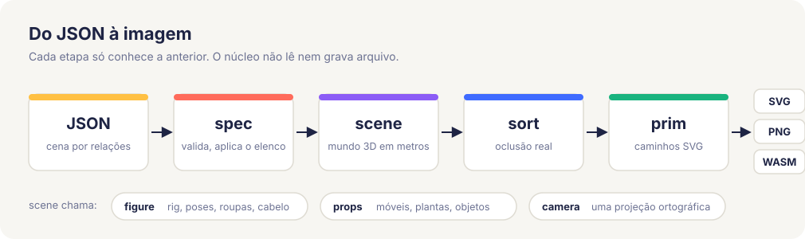</p>

### 1. Um mundo, uma câmera

O projeto nasceu como rival do `nova-svg`, que desenhava personagens em 2D, móveis num mini-3D e tinha uma câmera à parte. Cada sistema estava certo sozinho; os erros de perspectiva apareciam onde eles se encontravam.

Aqui tudo vive num mundo 3D em metros e passa pela mesma projeção ortográfica: personagens, móveis, plantas, animais, sombras e o chão.

<p align="center">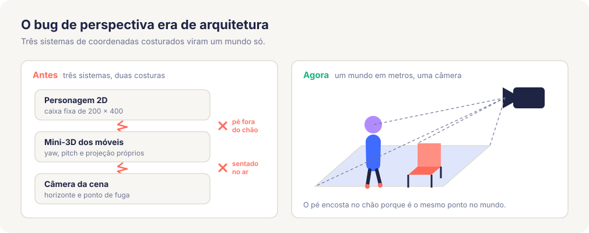</p>

A mesma cena funciona de frente, em três-quartos e em isométrico sem desenho especial por vista:

| `front` | `three-quarter` | `isometric` |
|---|---|---|
| 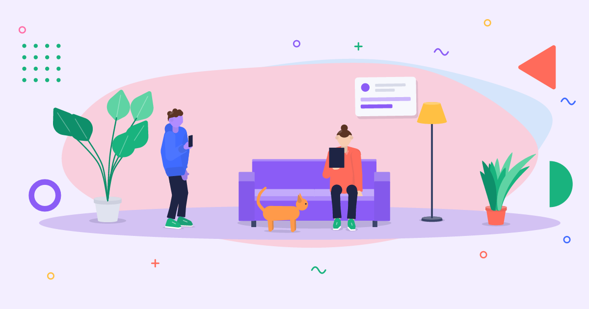 |  |  |

### 2. A pose são quatro metas

Cada personagem é um esqueleto 3D. A pose só diz onde ficam pés e mãos; joelhos e cotovelos saem por cinemática inversa, com o comprimento dos ossos preservado. Por isso sentar numa cadeira, pôr as mãos num teclado ou apontar para um quadro são a mesma operação: mover uma meta.

<p align="center">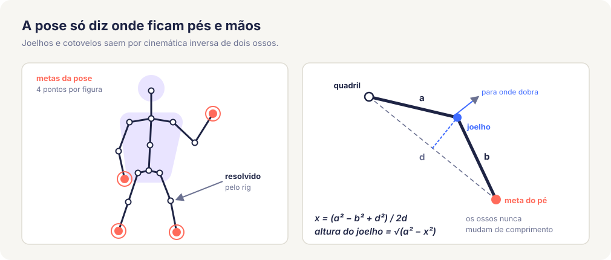</p>

`--rig` mostra o esqueleto por cima da cena:

<p align="center">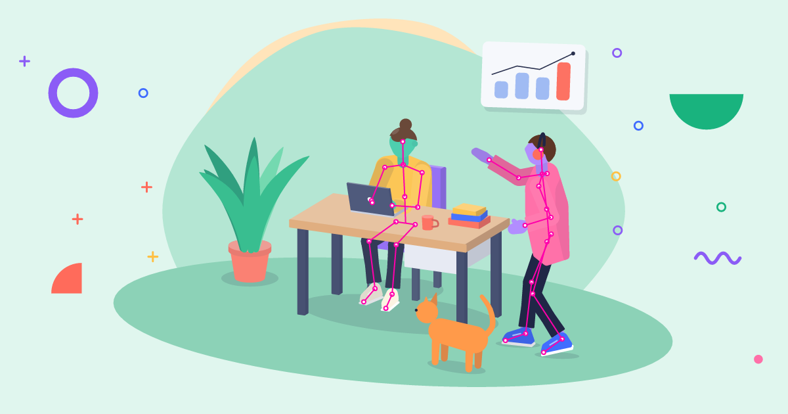</p>

<p align="center">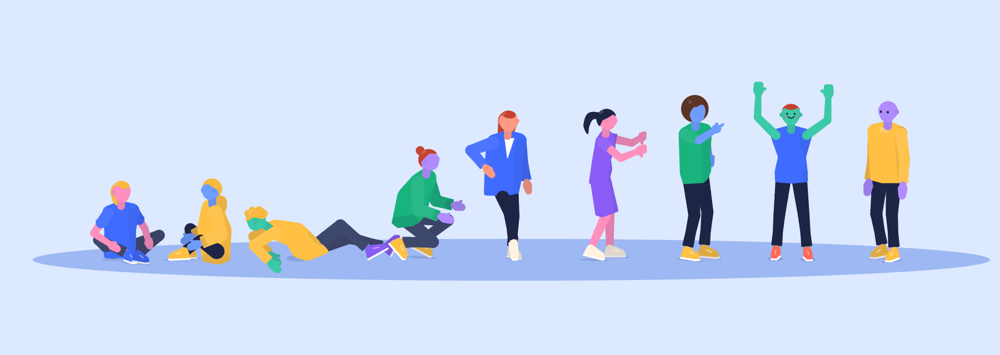</p>

### 3. Toda forma é um fecho de esferas

Uma esfera projeta como círculo de qualquer ângulo. Então um braço é o fecho convexo de duas esferas (ombro e cotovelo), e a silhueta dele vale em qualquer câmera. O SVG sai com arcos de verdade, não com polígonos.

<p align="center">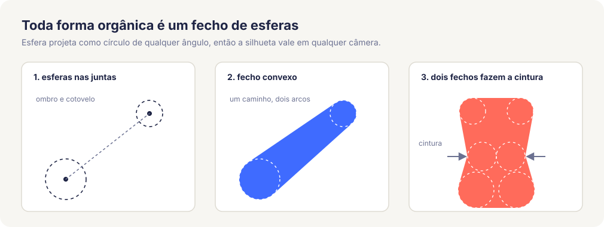</p>

O cabelo usa a mesma ideia ao contrário: é uma calota da esfera da cabeça. A linha do cabelo sai certa de frente, de perfil e de costas, sem um desenho por vista.

<p align="center">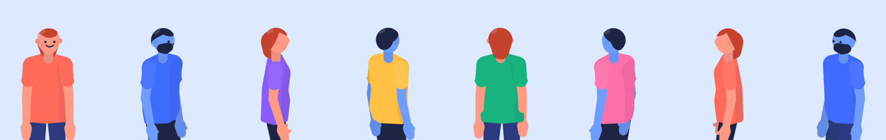</p>

### 4. A roupa veste o corpo que está por baixo

Um fecho convexo não tem cintura. O tronco são dois fechos (peito e quadril) que se encontram nela, e cada roupa tem um caimento: a regata acompanha o corpo, o moletom cai reto a partir do ponto mais largo.

<p align="center">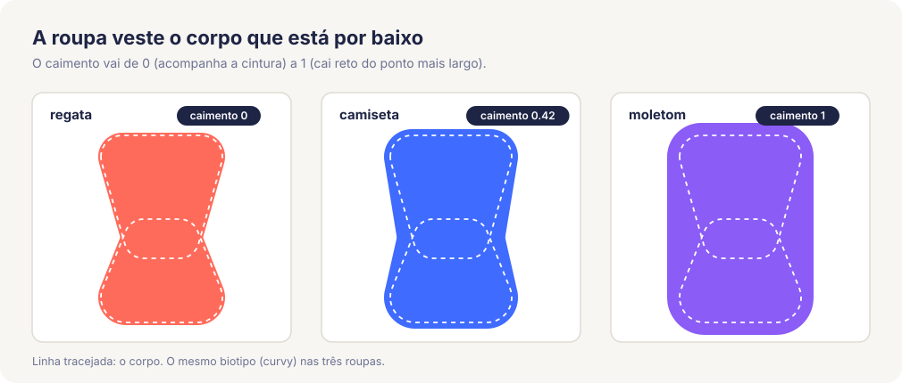</p>

`build` (`slim`, `regular`, `curvy`, `broad`) muda ombros, cintura, quadril, peito, barriga e a grossura dos membros, sem mexer na altura dos ossos:

<p align="center">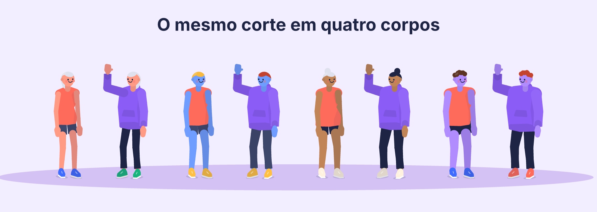</p>

### 5. Ordem de pintura por oclusão real

SVG não tem profundidade: o que é escrito depois fica por cima. Ordenar pela distância do centro erra com peças grandes (um tampo de mesa, um assento). Cada par que se sobrepõe na tela é julgado pelo plano da face, e o resultado vira um grafo ordenado topologicamente.

<p align="center">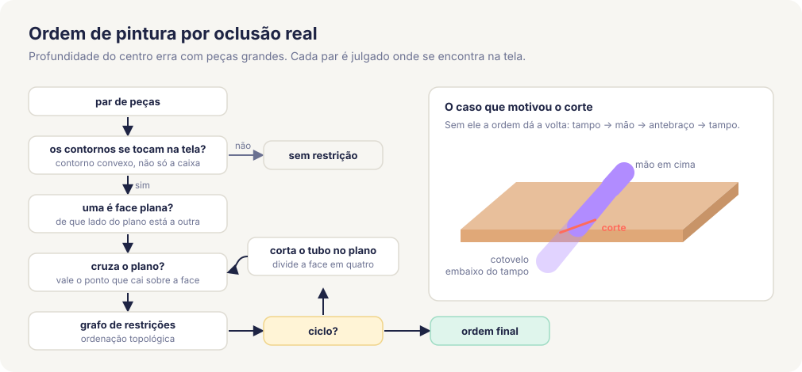</p>

### 6. Acabamento

Técnicas que não mudam o que a cena diz, só como ela lê:

- **Sombra tonal:** uma faixa mais escura no lado direito das formas grandes, recortada pela própria forma.
- **Três tons nos membros:** o de lá escurece, o de cá clareia. Um braço na frente do tronco da mesma cor continua legível.
- **Névoa de profundidade:** o que está longe puxa de leve para a cor do fundo.
- **Cabeça com queixo:** crânio mais mandíbula, para o rosto ter direção de perfil; franja, brilho no cabelo do lado da luz, bochechas no sorriso.
- **Detalhes de roupa:** cadarço, sola, punhos e barra canelados, queda dos ombros.
- **Enquadramento automático:** a cena é ajustada à área útil e a vinheta (blobs, formas, confete) é montada em volta do grupo, fora do título.

---

## Mais do que dá para fazer

### Objetos próprios

O que não existe no catálogo é descrito com seis formas em metros (`box`, `cylinder`, `sphere`, `hull`, `chain`, `panel`). Passa pela mesma câmera e pela mesma ordenação, então ganha oclusão, três tons e sombra como os nativos. Veja [examples/custom.json](examples/custom.json) e [objetos.md](skill/flatmates/references/objetos.md).

### Marca, elenco e tema escuro

`palette` troca os acentos pelas cores da marca, `background` deriva blobs e chão de uma cor de fundo, e `cast` + `who` mantêm o mesmo personagem entre cenas.

<table>
  <tr>
    <td></td>
    <td>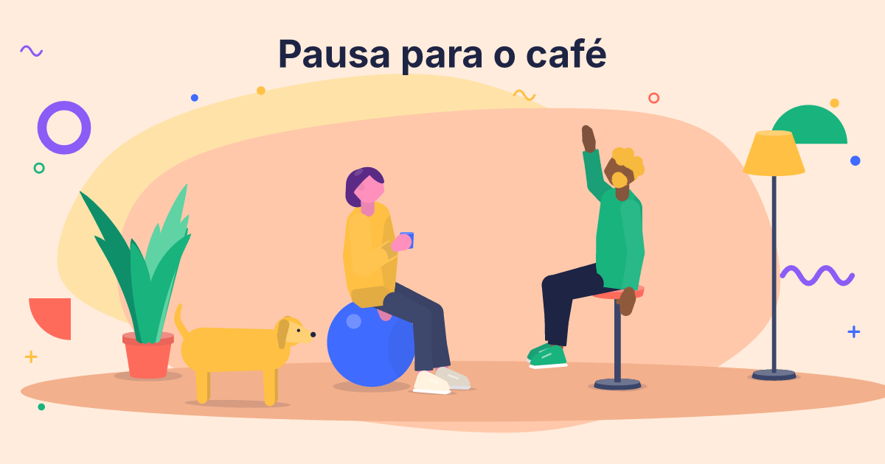</td>
  </tr>
</table>

### Animação

`motion` (`walk`, `run`, `wave`, `jump`, `type`) interpola poses-chave. Como o rig resolve qualquer pose, animar é só mover as metas.

<p align="center">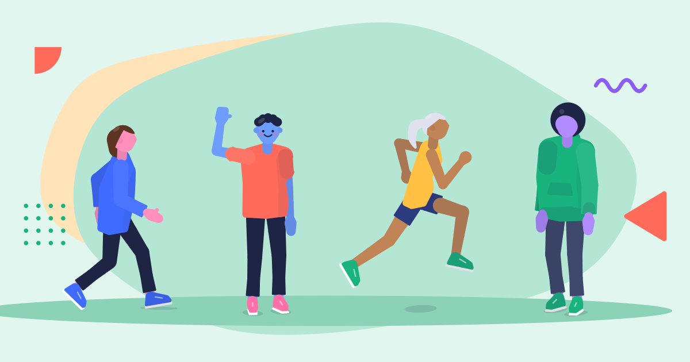</p>

```bash
flatmates animate examples/walk.json -o walk.svg --frames 12 --fps 12
```

### Editor ao vivo

O núcleo não faz IO, então compila para WebAssembly sem dependências de navegador.

```bash
./scripts/build-web.sh
```

```bash
python3 -m http.server 8731
```

Depois abra `http://localhost:8731/web/`.

### Skill para agentes

[skill/flatmates](skill/flatmates) traz o `SKILL.md`, as referências e um script por plataforma que escolhe o binário. O `flatmates-skill.zip` do release já vem com todos os binários: descompacte em `.claude/skills/`.

---

## O caminho até aqui

<p align="center">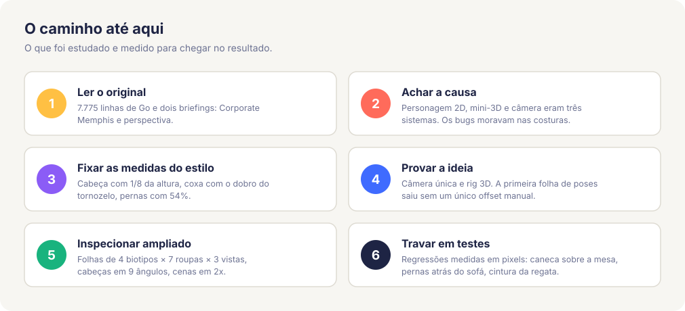</p>

O que cada etapa ensinou:

- **Ler o original.** Os dois briefings do `nova-svg` (Corporate Memphis e perspectiva) já tinham a pesquisa de estilo: cabeça pequena, membros longos, pele de fantasia, membro do lado de lá um tom mais escuro, 5 a 7 cores.
- **Achar a causa.** Sentar numa cadeira exigia acertar à mão três sistemas de coordenadas. Não era um bug para corrigir, era uma costura para remover.
- **Inspecionar ampliado.** As folhas de inspeção acharam o que as cenas escondiam: os quatro biotipos saíam quase iguais, a cabeça olhava para cima de perfil, o tornozelo aparecia por cima do sapato de costas, a barba cobria o rosto.
- **Travar em testes.** Cada bug de perspectiva corrigido virou um teste que mede pixels, não um teste que compara texto.

## Arquitetura

| Módulo | Responsabilidade |
|---|---|
| [spec](src/spec.rs) | Contrato do JSON, validação com a lista de opções válidas, catálogo |
| [scene](src/scene.rs) | Posições, apoios, assentos, contatos, olhares, sombras, avisos |
| [figure](src/figure) | Rig, poses, movimentos, corpo, roupas, mãos, cabeça e cabelo |
| [props](src/props.rs) | Móveis (sólidos em 3 tons), plantas, animais, telas, objetos próprios |
| [camera](src/camera.rs) | A câmera ortográfica única |
| [sort](src/sort.rs) | Ordem de pintura |
| [prim](src/prim.rs) | Geometria 3D para caminho SVG |
| [backdrop](src/backdrop.rs) | Vinheta Memphis em 2D |
| [text](src/text.rs) | Medição e quebra do título com as métricas da Inter |
| [raster](src/raster.rs), [wasm](src/wasm.rs), [main](src/main.rs) | As bordas: PNG, navegador e linha de comando |

O núcleo é puro: `flatmates::render(json)` devolve o SVG sem tocar em disco.

## Testes

```bash
cargo test --release
```

```bash
UPDATE_GOLDEN=1 cargo test --release
```

O segundo comando regenera os SVGs de referência depois de uma mudança visual intencional. O CI roda a suíte em macOS, Linux e Windows.

## Limites conhecidos

- Só projeção ortográfica, de propósito: é o que o estilo pede e o que mantém tudo coerente.
- Peças que realmente se atravessam geram aviso; a ordem ali é uma aproximação.
- A animação é uma troca de quadros, não interpolação de caminhos: o arquivo cresce com o número de quadros.
- A mão aberta e a saia são as partes mais simples do desenho.
- Sem balões de fala.

Fonte Inter © The Inter Project Authors, licença SIL OFL 1.1 ([assets/OFL.txt](assets/OFL.txt)).
